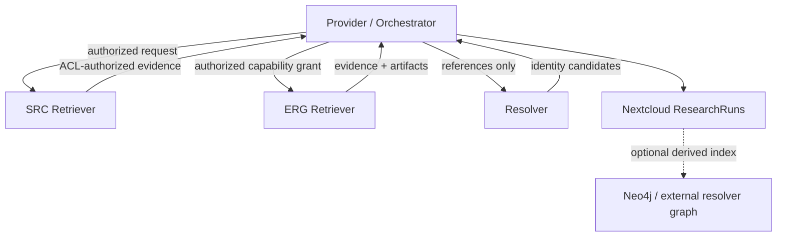

# Retrieval architecture prototype

**Status:** retrieval architecture for the `0.8.7-rc1` release candidate  
**Principle:** **modular first, distributed second**

This document defines the intended seams for incrementally reducing
`rag/openai_provider.py` without changing the current ACL, retrieval or evidence
semantics. It is a target architecture plus a migration plan, not a claim that
all components have already been extracted.

## 1. Decision summary

SunaQ separates four responsibilities:

1. The **Provider / Orchestrator** owns conversation and request flow, profile
   selection, intent/query analysis, capability selection, bounded planning,
   evidence merging and answer generation.
2. The **Resolver** answers who or what a reference denotes. It may search
   candidates and validate identity, but it is not a general enrichment or
   research pipeline.
3. The **SRC Retriever** is the secure internal retrieval core. It retrieves
   ordinary Nextcloud documents through Elasticsearch/FullTextSearch and ends
   with mandatory live Nextcloud authorization.
4. The **ERG retrieval layer** exposes explicitly enabled capabilities behind a
   generic interface. ERG Internal may add SunaQ-owned derived retrieval such as
   vectors or graph signals; ERG Full may additionally add external acquisition
   such as public Web or an external resolver.

`PrivateCandidate`, `AuthorizedDocumentEvidence`, `ExternalEvidence` and
`ResearchArtifact` are the provider-neutral trust classes. A private Qdrant or
Neo4j hit is deliberately not evidence: it must be hydrated through the
Nextcloud document path and pass live ACL before its content can enter the
Evidence Boundary. Nextcloud ResearchRuns remain the portable persistent
evidence. Any Neo4j / derived graph is an optional derived index, never the
only knowledge store.

The central authority rule is:

> Prompts and profiles influence behavior. Code and administrator configuration
> grant capabilities.

An LLM response can propose a query, reference or retrieval plan. It cannot add
a capability, change an endpoint, read a credential, raise a budget, bypass
live ACL, execute arbitrary Cypher/SQL, or modify retrieval configuration.

## 2. Current-state assessment

| Area | Current implementation | Main issue for modularity |
|---|---|---|
| Request orchestration | `rag/openai_provider.py` | Correct ownership, but mixed with HTTP wire schemas, result parsing, resolver research and persistence choreography |
| Internal retrieval execution | `rag/api.py`, `rag/search.py`, `rag/hybrid_search.py` | Mature security boundary, but one `/search` contract currently combines files, vector and graph arms |
| Retrieval policy | `rag/architecture_policy.py`, `rag/retrieval_policy.py`, `rag/retrieval_planner.py` | Already code-authoritative; should remain above concrete adapters |
| Resolver client | `rag/resolver_client.py` | HTTP transport and provider-facing normalization are coupled to dictionary payloads |
| Resolver gateway | `erg_resolver/app.py` | local and external identity-resolution adapters are currently mixed with enrichment/artifact production |
| Web research | `rag/web_research.py`, `/web/*` in `rag/api.py` | Good reference for a bounded ERG arm, but not yet behind the common retriever contract |
| Portable evidence | `rag/research_archive.py` | Provider-owned ResearchRun persistence; decision v2 and post-ACL execution v1 are implemented, while the generic typed artifact sink remains incomplete |

The provider must remain the orchestrator during the migration. Extraction
means moving capability implementations and transport schemas behind explicit
interfaces, not replacing the provider with a workflow engine.

## 3. Target responsibility map



### 3.1 Provider / Orchestrator

The provider owns:

- request and conversation orchestration;
- model/profile loading and role routing;
- intent and structured query analysis;
- applying architecture, profile and administrator capability policy;
- constructing immutable budgets and capability grants;
- selecting resolver/retriever calls;
- merging, deduplicating and budgeting normalized evidence;
- candidate verification, evidence control and answer generation;
- ResearchRun lifecycle and persistence decisions.

It must not own long-term provider-specific search schemas. A planner returns an
advisory plan; the provider intersects it with the configured capability
envelope before calling an adapter.

#### 3.1.1 Retrieval Decision Record

The first query-analysis phase produces a structured, inspectable
`RetrievalDecisionRecord` before retrieval execution. Its purpose is to make
search-strategy quality observable without exposing hidden model reasoning or
turning model prose into an authority boundary.

The persisted ResearchRun representation is
`retrieval-decision.v2.json`. It separates:

1. **Planner proposal** — normalized semantic intent, entities, entity hints,
   concepts, concept groups, constraints, semantic query and verification
   requirements.
2. **Policy resolution** — deterministic architecture/profile/config decisions,
   granted or denied capabilities and stable reason codes.
3. **Effective plan** — granted retrieval/source/resolver capabilities plus
   immutable execution budgets.

The planner proposal is backend-neutral. In particular, it does not own an
Elasticsearch query language. The current planner contract does not emit
`elastic_query`; deterministic retriever compilers own backend syntax.

The v2 record intentionally contains no backend query syntax, hidden repository
candidates, pre-ACL hit counts, raw private graph hits or backend ranks/scores.
It is an audit record of **what was understood and granted**, not what the
backend happened to return.

The record is safe to expose on the identity-scoped inspection surface and to
persist in the user's ResearchRun. Normal operation does not pause for manual
approval.

#### 3.1.2 Retrieval Execution Record

Execution provenance is separate because it crosses a different trust boundary.

`retrieval-execution.v1.json` records **what was actually executed**, but
portable private-document provenance starts only after live Nextcloud ACL.
The record may contain the actual backend queries because query syntax itself
does not reveal which hidden documents matched. Candidate provenance is more
restricted:

- only ACL-authorized private document candidates may appear;
- ranks are expressed within the authorized candidate list;
- raw ES/RRF/vector ranks and scores are not copied;
- raw hit counts are not persisted;
- verifier decisions are persisted only when their document ID is present in
  the authorized candidate set;
- final selected documents are recorded explicitly.

This avoids turning diagnostics into an authorization side channel. Protected
server logs may retain richer pre-ACL telemetry for operators, but that data is
not part of portable ResearchRun provenance.

`documents.json` is narrower again: it records the authorized documents that
actually reached the answer context and follows the same post-ACL rank rule.

The resulting provenance chain is:

```text
retrieval-decision.v2.json
    what was understood / granted
          ↓
retrieval-execution.v1.json
    what was executed / authorized / verified
          ↓
documents.json
    what actually reached the answer model
```

**Prototype status:** decision v2, execution v1, ResearchRun persistence and the
native Nextcloud decision-inspection surface are implemented on this branch.
The records remain observational; they do not grant capabilities or modify the
effective plan.

### 3.2 Resolver

The resolver contract accepts bounded references, local context hints and an
administrator-authorized adapter set. It returns identity candidates with a
stable adapter ID, canonical name, aliases, kind, confidence and provenance.

It may perform:

- local Neo4j entity/alias lookup;
- candidate search and disambiguation;
- external resolver validation;
- external resolver identity search;
- explicitly configured external resolution through an adapter.

It does not return general financial data, holdings, source documents or a
research dossier. Those belong to an ERG Retriever.

The resolver gateway is now a regular Standard installation component,
bound locally on `127.0.0.1:8770`:

- SRC disables the gateway;
- ERG Internal permits local adapters such as Neo4j;
- ERG Full additionally permits explicitly configured external adapters such as
  external resolver/external resolver.

The old `install/resolver-prototype` packaging remains only as historical
prototype material. SRC no longer has a Neo4j seed/alias exception: query
context from graph/resolver state belongs to ERG Internal or ERG Full.

### 3.3 SRC Retriever

The `SrcRetriever` interface contains no arm selector, endpoint, credentials or
configuration mutation field. Its implementation is fixed to:

- ordinary Nextcloud Documents;
- Elasticsearch / Nextcloud FullTextSearch candidate retrieval;
- current deterministic ranking/reranking policy;
- mandatory final live Nextcloud ACL for the current request identity.

Nextcloud remains both the authoritative data source and the final
authorization authority. Index hits are candidates only. Failure of live ACL
fails closed according to the existing runtime contract.

### 3.4 ERG Retriever

The `ErgRetriever` receives an explicit immutable `CapabilityGrant` created by
code after architecture/profile/config validation. The grant accepts only
code-known capabilities such as `vector`, `research-graph`, `web` and
`openregister-research`; unknown strings fail validation.

The generic request contains resolved entities, research goals and bounded
constraints, but no provider endpoints, raw API schemas, credentials, arbitrary
query languages or configuration updates. Each adapter owns its provider-
specific request/response mapping.

Trust class is explicit in the result: private Qdrant/research-graph arms return
`PrivateCandidate` values without content/snippets; external/public research
arms may return `ExternalEvidence` and optional `ResearchArtifact` descriptors.
Private candidates become `AuthorizedDocumentEvidence` only after authoritative
Nextcloud hydration and live ACL.

An ERG implementation must reject an unknown or ungranted capability. It may
use a shared in-process registry initially and a shared ERG HTTP service later.
One microservice per adapter is not a goal.

### 3.5 Web Retrieval vs. Delegated Research (0.8.7-rc1 decision)

**Architecture decision:** The Web capability has two *different kinds of
backend*, selected by the effective **SunaQ model package**. A backend is not an
LLM role. LLM role selection (planner/verifier/answer) remains independent.

1. **Web Retrieval** returns candidate public sources, extracted context or
   normalized Web Evidence. SunaQ controls evidence selection, verification,
   synthesis and answer generation. The existing Brave Search + fetch/relevance
   pipeline is retained. Brave LLM Context is a prospective extraction-oriented
   Web Retrieval adapter, **not** a Delegated Research Provider.
2. **Delegated Research** owns public-web search *and* answer synthesis, and
   returns the final answer together with normalized citations, consulted
   sources, provider queries and usage. OpenAI Responses/Web Search is the first
   implemented adapter. Gemini and Brave Answers are possible later adapters;
   their existence here does not mean that integrations already exist.

~~~text
                         SunaQ model / admin policy
                                   |
                            Provider/Orchestrator
                              /           \
                Web Retrieval             Delegated Research
                  /      \                 /       |       \
           Brave Search  Brave            OpenAI  Gemini  Brave Answers
                         LLM Context        (future integrations in grey)
                  |                            |
           Web Evidence                 answer + provenance
                  |                            |
           SunaQ answer                        +--------+
                  \                                     /
                   +----> Chat ResearchRun / citations +
~~~

The ERG capability policy decides whether Web is allowed at all. The effective
model then chooses one **registered, administrator-enabled backend by ID**.
The user can still select *Documents*, *Web* or both within an allowed hybrid
model. Choosing Web does not give the planner authority to select another
provider, endpoint, credential or trust policy.

**Model classes** are a capability/policy boundary, not a second conversational
workflow engine:

- An **internal-research model** forbids the Web capability. Its normal private
  Nextcloud live-ACL rules remain in force. Independent model-role egress
  (e.g. an administrator-approved external answer LLM) remains governed by its
  own established policy; "no Web" does not by itself mean "no external LLM".
- A **hybrid-research model** permits internal and public Web research in one
  continuous conversation, without presenting artificial context partitions to
  the user. Admin entitlements decide who can select that model. A change from
  Documents to Web may use conversation context but does **not** authorize
  unguarded disclosure of private evidence.

### 3.6 Backend registry and model binding (initial implementation)

The proposed configuration separates centrally owned backend definitions from
request-local model decisions. The following illustrates the registry syntax now understood by the provider:

~~~yaml
# config.yaml: administrator-owned service registry
research_backends:
  brave-search:
    kind: web_retrieval
    adapter: brave_search
    enabled: true
  brave-context:
    kind: web_retrieval
    adapter: brave_llm_context
    enabled: false
  openai-research:
    kind: delegated_research
    adapter: openai
    enabled: true
    # Credentials, endpoint and hard limits remain globally controlled.
    api_key_env: LLM_API_KEY
  gemini-research:
    kind: delegated_research
    adapter: gemini
    enabled: false

# models/hybrid-openai/profile.yaml: model-owned choice and upper bounds
capabilities:
  documents: true
  web: true
research:
  web_backend: openai-research

# models/internal/profile.yaml
capabilities:
  documents: true
  web: false
research:
  web_backend: none
~~~

The runtime must validate backend IDs and kinds at startup and resolve the
effective capability as the intersection of architecture tier, global policy,
configured backend, model envelope and per-user entitlements. A model may
reference a backend but cannot register one, activate a globally disabled one,
modify a credential or increase any global budget. An invalid or disabled
backend fails closed, with an actionable configuration diagnostic; there is
no silent fallback to a different paid/external provider. The backend choice
and effective grant must appear in the safe retrieval/research decision record.

The existing Standard / Thorough / Deep profiles (current German labels: `Schnell / Gründlich / Tief`) remain performance/budget
profiles. A model's security/capability envelope and backend binding are
orthogonal to its depth and LLM roles. Administrators may expose multiple
user-visible model packages with different research backends and entitlements;
the UI continues to hide globally unavailable capabilities.

### 3.7 Egress and conversation semantics

In a continuous chat the conversation may contain both internal document facts
and public facts. No attempt is made to infer the confidentiality of arbitrary
sentences by LLM heuristics. 0.8.7-rc1 uses one deterministic outbound policy contract
with three classes:

- `research_query`: Brave/SearX-style search, delegated research and external
  resolver references. Default mode is `guard`.
- `model_processing`: remote planner/verifier/evidence/answer/follow-up
  payloads. Default mode is non-destructive `audit`.
- `embedding`: text sent to an external embedding service. Default mode is
  `allow`.

Each class can be configured as `allow`, `audit`, `guard` or `block`.
`guard` performs deterministic credential and administrator-regex redaction;
it is deliberately not an LLM confidentiality classifier. Resolver-local
context used only for candidate ranking is not redacted when only the reference
text crosses the external adapter boundary.

This separation is intentional: silently rewriting verifier/answer evidence or
embedding input can change the function of the system. Administrators who
explicitly authorize those external processors may still select `guard` or
`block`, but 0.8.7-rc1 does not impose destructive redaction by default. Sending raw
documents or arbitrary chat history to a delegated Research Provider remains out
of scope; delegated research continues to receive a bounded public research
query rather than private document evidence.

### 3.8 Shared provenance, snapshots and cost visibility

Both backend classes write ResearchRun provenance under the owning Nextcloud
Chat archive, not a separate Webarchiv category. The answer and citations are
distinguished from optional **locally captured snapshots**; an externally
reported URL does not prove that SunaQ downloaded the same content that the
provider read.

Where archival is enabled, the system should attempt to capture only
**answer-used public sources**, keeping retrieval metadata, retrieval time,
final URL, MIME type, status and content digest. Normal HTTP fetch and original
content capture come first; the existing optional network-isolated Playwright
HTML-to-PDF renderer enriches successfully fetched HTML. Browser navigation
with live JavaScript would require a separately hardened, explicitly enabled
fetch capability; do not silently relax the renderer's no-network isolation.
Failure to archive a URL must be recorded, not disguised as an archived source
or allowed to invalidate a successful answer. Content-rights and permitted-use
restrictions remain applicable.

Research-run diagnostics should record backend ID, calls, latency, citation
counts, input/output token usage where provided, and *estimated* costs only
when grounded in a configured price schedule. No implicit cheapest-provider
switching or hidden retries across providers. Admins can compare Brave Search,
Brave LLM Context and Delegated Research without changing the chat UI.

### 3.9 Migration status (October 2026)

The current prototype has *two* hard-coded paths, not the target registry:

- Existing SunaQ native Web Retrieval uses 'rag/web_research.py', with Brave
  Search, subsequent fetch/relevance checks and optional Chat ResearchRun
  snapshots.
- OpenAI delegated **Web-only** mode uses 'rag/research/' and is configured
  globally through 'delegated_research' or the temporary
  'SUNAQ_RESEARCH_PROVIDER=openai' environment override. It writes
  'web/provider.json'. Mixed Documents + Web remains on the native path.

The first per-model registry slice is implemented in 0.8.7-rc1:
'config.yaml:research_backends' definitions, per-profile 'research.web_backend',
per-model capability checks, and native/OpenAI Web-only routing. Unbound old
profiles keep global delegated_research/environment routing. Mixed
Documents+Web requests for delegated backends fail explicitly until a separate
hybrid egress contract is available.

Brave LLM Context, Brave Answers, Gemini and shared delegated source snapshots
are still planned and not currently available. The common class-aware egress
policy is implemented; protected contextual rewrite remains administrator-policy
dependent because remote model processing defaults to `audit`, not destructive
redaction. The guard is not a general DLP guarantee.

## 4. Contracts introduced by the first slice

The initial contracts live in `rag/retrieval/contracts.py`.

| Contract | Purpose | Authority property |
|---|---|---|
| `RetrievalIdentity` | Carries opaque user/group/request scope | Does not carry credentials; groups are structurally separate |
| `RetrievalBudgetGrant` | Code-issued result, round and evidence limits | Enforces global hard caps in addition to positivity |
| `CapabilityGrant` / `ResolverGrant` | Code-issued capability envelopes | Reject unknown/unregistered capabilities/adapters |
| `SrcRetrievalRequest` | Requests secure internal document evidence | Has no ERG capability or endpoint selector |
| `ErgRetrievalRequest` | Requests explicitly granted research capabilities | Uses typed entities/goals/constraints, not an arbitrary context blob |
| `PrivateCandidate` | Opaque private recall/ranking signal | Has no evidence text/snippet channel |
| `AuthorizedDocumentEvidence` | Private document evidence | Exists only after authoritative Nextcloud live ACL |
| `ExternalEvidence` | Explicit external/public research evidence | Kept distinct from private document authorization |
| `RetrievalBatch` | Typed retriever output | Keeps candidates, document evidence and external evidence structurally separate |
| `ResolutionRequest` / `ResolutionBatch` | Identity resolution input/output | Contains references and candidates, not enrichment |
| `ResearchArtifact` | Portable inline or remote artifact descriptor | Remote mode accepts HTTPS only and no arbitrary headers |
| `ResearchArtifactSink` | Persists a `MaterializedResearchArtifact` after provider-side fetch/policy checks | Keeps Nextcloud persistence under provider authority |
| `Resolver`, `SrcRetriever`, `ErgRetriever` | Structural async interfaces | Allow local or HTTP implementations without changing orchestration |

`rag/retrieval/middleware.py` contains two adapters:

- `MiddlewareRetrievalClient` extracts the existing `/search` HTTP schema and
  response normalization from the provider. It is explicitly transitional
  because that endpoint still supports mixed files/vector/graph retrieval.
- `MiddlewareSrcRetriever` is the first strict `SrcRetriever` implementation.
  It fixes the request to `retrieval_arms=[files]` and
  `source_scopes=[documents]`; callers cannot change either through its
  contract.

The provider's `_rag_search` wrapper now selects the strict
`MiddlewareSrcRetriever` whenever the effective request is exactly the ordinary
`files` / `documents` capability. The adapter issues a code-fixed files arm
and documents scope, requires a positive live-ACL confirmation and returns
`AuthorizedDocumentEvidence`.

`rag/retrieval/erg.py` provides a transitional explicit
`MiddlewareErgRetriever` for the *internal* ERG capabilities `vector` and
`research-graph`. It reuses the current combined middleware endpoint, carries
the normalized structured planner inputs, requires live-ACL confirmation and
rejects external capabilities such as `web` and `openregister-research`.

The provider now routes pure internal vector/graph requests through this typed
adapter. Mixed files+vector/graph execution remains on the existing combined
middleware path because current joint fusion/reranking semantics must remain
unchanged until parity tests cover a split execution/merge path. Archive scopes
likewise remain on the compatibility path.

### 4.1 Proposed module structure

The prototype deliberately starts with one small package:

```text
rag/retrieval/
    __init__.py
    contracts.py       # provider-neutral value objects and Protocols
    middleware.py      # current HTTP wire adapter + strict SRC adapter
    erg.py             # explicit internal-ERG compatibility adapter
```

Only after another implementation is extracted should it grow toward:

```text
rag/retrieval/
    contracts.py
    src.py             # SRC composition, no ERG selectors
    erg.py             # capability registry and generic ERG dispatch
    adapters/
        web.py
        openregister.py
        vector.py
        research_graph.py
rag/resolution/
    contracts.py
    service.py
    adapters/
        neo4j.py
        openplz.py
        openregister.py
rag/research_artifacts.py
```

This is a responsibility layout, not a service-per-directory deployment plan.
The Resolver contracts remain in `rag/retrieval/contracts.py` for the first cut
to avoid creating empty packages; they can move without changing callers once a
typed resolver adapter is implemented.

## 5. external resolver role split

external resolver legitimately has two independent roles:

| Role | Input | Output | Must not do |
|---|---|---|---|
| Resolver adapter | Reference text, bounded context, hints | Candidate IDs, canonical names, aliases, identity provenance | Fetch broad dossiers, finances or documents automatically |
| ERG retriever adapter | Authorized capability grant plus resolved identity/research query | Structured evidence and `ResearchArtifact` descriptors | Alter identity policy, write Nextcloud/Neo4j directly, expose provider schema to the planner |

The current `/enrich` path and artifact generation in `erg_resolver/app.py` are
preserved as prototype behavior. They are transitional placement, not the
target contract. Extraction should first wrap this code as an external resolver ERG
adapter; only then should it be moved out of the resolver gateway.

external resolver graph persistence remains downstream of portable ResearchRun
persistence. A failed graph write must not invalidate an otherwise complete
portable dossier.

## 6. Evidence and persistence lifecycle

1. A private retrieval arm returns candidate locators/ranking signals.
2. The authoritative Nextcloud document path applies mandatory live ACL; only
   authorized candidates may become private document evidence.
3. The API response deliberately suppresses pre-ACL candidate counts when live
   ACL is active.
4. The Provider reconstructs its candidate list only from this ACL-filtered
   response and assigns/retains **authorized ranks**, not backend ranks.
5. Candidate Verification runs only on that authorized pool.
6. `retrieval-execution.v1.json` may persist executed queries, authorized
   candidates, verifier decisions for authorized documents and final selection.
   It does not persist pre-ACL hit counts/ranks/scores.
7. `documents.json` records only the authorized evidence that reached the
   answer context.
8. Explicit external/public ERG arms may return `ExternalEvidence` and bounded
   `ResearchArtifact` descriptors according to their own trust policy.
9. The provider validates/fetches remote artifacts through the shared
   public-egress/SSRF policy and writes bytes through the Nextcloud ResearchRun
   sink.
10. Optional graph indexing consumes persisted/provenance records; it is never
    the sole portable evidence store.

No resolver or ERG service receives Nextcloud credentials or chooses arbitrary
ResearchRun paths.

## 7. Capability and security enforcement

| Decision | Advisory input | Authoritative enforcement |
|---|---|---|
| Which capability might help | Planner/profile prompt | Architecture policy + administrator config + code allowlist |
| Retrieval arms | Planner proposal | `retrieval_policy` and architecture-tier gates |
| Result/round/evidence budgets | Profile hints | Immutable code-created `RetrievalBudgetGrant` plus global hard caps |
| Private document access | Retrieval candidates | Final live Nextcloud ACL |
| External destination | Adapter choice | Configured adapter endpoint and network/SSRF policy |
| Neo4j operations | Structured adapter method | Fixed parameterized queries owned by implementation |
| Persistence | Adapter artifact proposal | Provider policy and `ResearchArtifactSink` |

The interfaces intentionally have no method for arbitrary SQL/Cypher, shell
commands, environment reads, credential lookup or configuration mutation.

## 8. Deployment model

Python interfaces are the primary boundary. The same contracts may be backed by
local objects or a narrow HTTP transport.

Plausible later deployment:

- Provider / Orchestrator;
- SRC Retrieval Core (the current middleware boundary is already close);
- optional shared ERG service containing the Resolver and multiple ERG
  retriever adapters.

Good future HTTP candidates are the SRC retrieval core and a shared ERG service
when isolation, different network placement or scaling requires it. Individual
external resolver, external resolver, graph and Web adapters should remain internal modules of
the ERG service unless an operational trust boundary requires otherwise.

ResearchRun persistence should remain provider-side because the provider owns
the user-scoped Nextcloud credential and dossier lifecycle. LLM role routing and
conversation state likewise remain provider responsibilities.

## 9. Configuration composition

`config.yaml` should remain the composition root and contain global security,
architecture and infrastructure decisions: tier, ACL, enabled capability set,
service locations, hard budgets and persistence policy. Secrets continue to use
the established file-backed environment mechanism, not YAML.

Capability-specific files are justified only by an independent operational or
trust boundary:

- `web.yaml` remains the Web/search/fetch policy example;
- `resolver.yaml` may later contain resolver adapter enablement, limits and
  disambiguation policy;
- `openregister.yaml` may contain separate `resolution` and `research` sections
  plus non-secret endpoint/policy values;
- `erg.yaml` is useful only if a shared ERG service needs its own composition
  root and deployment policy.

Loading order should be deterministic: shipped defaults, capability file,
global composition overrides, then supported environment overrides. Unknown
keys and invalid capability combinations should fail validation. Configuration
must never select an arbitrary Python import path supplied by an LLM or request.

No YAML file is proposed merely because a Python module exists.

## 10. Responsibilities still in `openai_provider.py`

After this first cut the provider still contains:

- query rewrite, planner and conversation control;
- capability-policy selection;
- query-context acquisition;
- legacy multi-search, direct Elasticsearch, document-resolution and Web HTTP
  paths;
- candidate verification and evidence control;
- answer-context budgeting, citation mapping and answer generation;
- resolver call/enrichment choreography;
- artifact download/validation and ResearchRun writing;
- optional external resolver graph persistence;
- response streaming and OpenAI compatibility.

This list is deliberate migration scope, not an invitation to a single large
rewrite.

## 11. Recommended extraction sequence

1. **Implemented:** route the files/documents-only orchestration path through
   `SrcRetriever`, with contract tests covering the fixed capability envelope,
   provider result/control-payload behavior and fail-closed ACL confirmation.
   The current mixed adapter remains the ERG compatibility fallback.
2. **Implemented:** publish `retrieval-decision.v2.json` after query analysis/policy resolution and before retrieval execution; it contains structured intent, policy and bounded budgets but no backend syntax.
3. **Implemented:** publish `retrieval-execution.v1.json` from the post-live-ACL evidence stream; persist executed queries plus authorized candidates/verifier decisions/selection without raw hit counts, denied candidates or pre-ACL backend ranks/scores.
4. **Partially implemented:** an explicit internal `MiddlewareErgRetriever`
   now owns the typed vector/research-graph compatibility boundary. Add the
   in-process ERG registry whose keys are code-known capabilities; wrap Web next
   because it already has a separate bounded implementation.
5. Wrap external resolver enrichment/artifacts as `openregister-research`, leaving
   identity search behind `Resolver`.
6. Adapt `ResearchArchive.write_external_source` to `ResearchArtifactSink` and
   move artifact choreography out of the main request function.
7. Split vector and research-graph execution from the combined middleware API
   only after parity tests cover ACL ordering, budgets, citations and source
   scopes.
8. Consider an HTTP transport for the shared ERG boundary after the local
   interfaces and failure semantics are stable.

## 12. Open questions and known risks

- The combined `/search` endpoint currently fuses files/vector/graph before the
  provider sees results. Splitting execution too early could change ranking,
  completeness and ACL-visible result counts. Arm adapters therefore return
  candidates/signals; there must remain one explicit joint fusion/reranking
  authority before the final evidence set is selected.
- Qdrant and private Neo4j document-graph output must never be promoted directly
  to evidence. Their future adapters must emit `PrivateCandidate` only; private
  content is hydrated and authorized through Nextcloud before Evidence Boundary
  serialization.
- `source_scopes` are orthogonal to retrieval arms today. The strict SRC
  contract fixes `documents`; ERG archive scopes need an explicit home during
  the split.
- Resolver ambiguity and local Neo4j precedence are mature behavior in
  `rag/resolver_client.py`; typed adaptation must preserve it exactly.
- `ResearchArtifact` has a generic contract, while the resolver service still
  exposes a Pydantic wire model. One adapter should own that conversion rather
  than importing service models into the provider core.
- Failure semantics must remain capability-specific: SRC ACL failures are
  security failures, while optional ERG enrichment/index failures may remain
  fail-open where already documented.

These risks are why the first implementation slice moves transport and parsing
without changing retrieval selection, ranking or authorization behavior.
